# CAIS user manual

CAIS is the Centralized Assistance Information System. This manual follows each job from sign-in through the work that job owns.

A person can hold more than one role. The sidebar and the buttons follow the roles on the account. Department staff see only their own department. The administrator, the executive, and the super admin can open records from every department.

Field-by-field help for forms, eligibility, stock, and receipts is in the [user guide](user-guide.md).

## Sign in

Open CAIS and sign in with the email and password on the account. If two-factor authentication is on, enter the code from the authenticator app, or a recovery code.

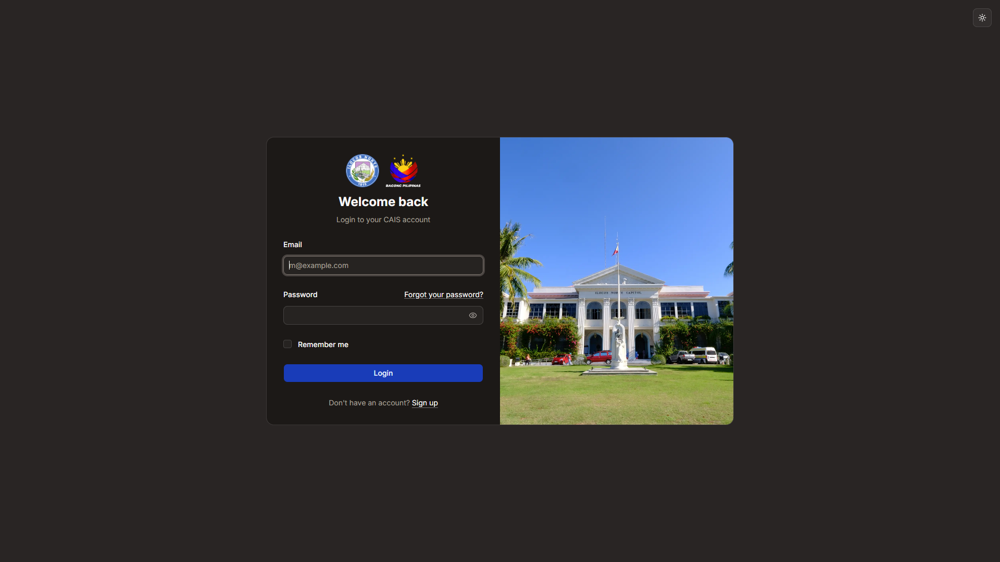

After sign-in, department staff land on the department dashboard. An administrator lands on **Programs** under Administrator. An executive lands on the executive dashboard.

Use **Forgot your password?** on the sign-in page if you cannot get in. You need access to the email on the account.

## How a program becomes active

A program has to be approved before staff encode into it and before a batch distribution can be released.

1. The **department head** creates the program and sends it on. The button is **Submit for recommendation**. The status becomes **Awaiting administrator**.
2. The **administrator** opens **Programs**, finds the program under **Awaiting administrator**, and chooses **Recommend for approval**. The status becomes **Awaiting Governor Approval**. **Return** sends it back to the department.
3. The **executive** opens **Programs**, finds the program under **Awaiting Governor Approval**, and chooses **Approve**. The status becomes **Approved**. **Return to department** sends it back.

A program with batches is submitted one batch at a time. The parent itself is not submitted.

## How a request is handled

1. An applicant submits from **Apply for assistance**, or an **encoder** adds the request on an approved program or batch.
2. The request enters the department workflow. The default path is Submitted, Verify beneficiary, Evaluate, Approve, Prepare, Release, then Completed.
3. A **verifier** claims the current task and moves it with the buttons on the request. A deny asks for a comment. On Hold pauses the time target.
4. Goods or cash are handed over in a **distribution**, recorded by the **releasing officer**. CAIS will not mark the request delivered until that distribution is recorded.

## How a distribution is released

Individual distributions go out directly. Batch distributions wait for approval.

1. The **releasing officer** or **department head** creates the batch and builds the roster.
2. **Validate**, then **Submit for approval**.
3. The **administrator** endorses the batch. The **executive** approves it, returns it, or rejects it. They can approve the whole batch or selected beneficiaries, then **Finalize review**.
4. After approval, department staff **Schedule** the venue and time, choose **Start distribution**, record each release at the venue desk, and choose **Complete** when every approved beneficiary has an outcome.

## Department head

The department head formulates the department’s programs and sends each one for approval. The sidebar also includes distributions, the queue, beneficiaries, items, and funds.

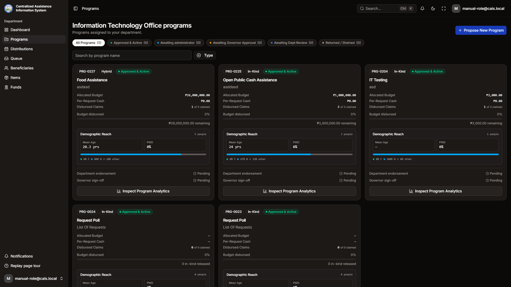

### Set up, then submit

1. Open **Funds** and add the budget you will attach to the program.
2. Open **Items** and add the goods, cash, or services the program can give. For goods, record stock from the item’s stock drawer.
3. Open **Programs** and choose **Propose New Program**.
4. Set the type, dates, whether it is open, the funds and items, questions, document rules, and eligibility. Turn on public intake when residents should apply online.
5. Open the draft and choose **Submit for recommendation**. You can add a remark. The program locks for review until an administrator and then the executive decide.
6. If it comes back as **Returned**, change it and send it again.

On a batch series, open the parent and submit each batch on its own. Staff encode on a batch, not on the parent.

The department head can also create a distribution batch, validate it, and submit it. Approval of that batch stays with the administrator and the executive.

## Encoder

The encoder adds assistance requests onto an approved program or batch, and can add the beneficiary the request is for. The sidebar is Dashboard, Programs, Queue, and Beneficiaries.

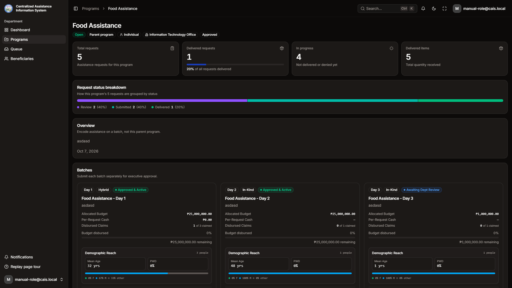

### Encode a request

1. Open **Programs** and open an approved one-off program, or a batch under a parent. A parent has no encode button.
2. On the assistance list, choose **Add Assistance**.
3. Search for the beneficiary by CAIS number or name. Create the person or organization first if they are not in the registry.
4. Choose how the request arrived, the items, any program questions, and a remark if you need one.
5. Read the eligibility panel, then save.

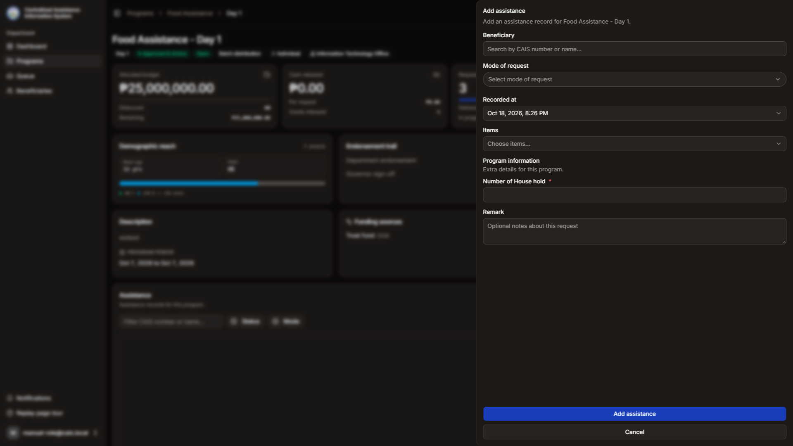

The request enters the workflow at Submitted. The encoder does not move the status after that.

## Verifier

The verifier checks a request and moves its status. The sidebar matches the encoder: Dashboard, Programs, Queue, and Beneficiaries. The verifier does not add new requests.

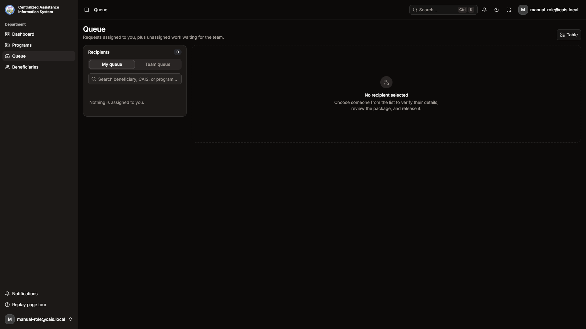

### Work the queue

1. Open **Queue**.
2. **My queue** lists requests assigned to you. **Team queue** lists unassigned work for someone with your role.
3. Open a request. If the task has no assignee, choose **Claim task**.
4. Under **Current task**, use the buttons for the allowed moves, such as advance, hold, deny, or close. A deny asks for a comment.

Only the assignee for the current step can change the status. Attach any required documents before the step that needs them. The usual required points are before Verified and before Delivered.

When the request is ready to be handed over, leave the release to the releasing officer. Marking the request delivered asks for a completed distribution first.

## Releasing officer

The releasing officer builds distribution batches and records what was handed over. The sidebar adds Distributions and Items to the department pages. The releasing officer does not approve a program or a batch.

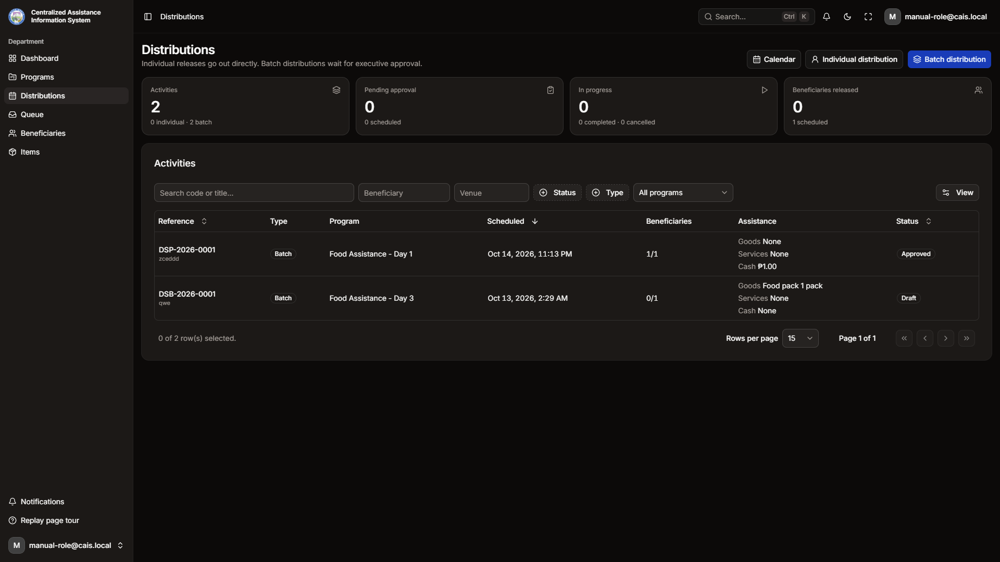

### Run a batch

1. Open **Distributions**.
2. Choose **Batch distribution** and build the roster. Choose **Individual distribution** when one person is released at the counter without the approval queue.
3. On a draft or returned batch, choose **Validate**, then **Submit for approval**.
4. Wait for the administrator and the executive. If the batch is returned, edit the roster and submit it again. If it is rejected, **Reopen as draft** when that option is available.
5. After approval, choose **Schedule** and enter the time and venue.
6. Choose **Start distribution**. Open **Venue desk** and record each release. Issue the acknowledgment receipt from the release. If a phone record is refused, the venue desk and the batch page show the reason under Field sync.
7. Choose **Complete** when every approved beneficiary has a release outcome.

**Cancel** is available before the batch is in progress. A void or a reprint stays on the release, for an officer who has that permission.

## Inventory officer

The inventory officer keeps the department item list and the stock of goods. The sidebar is Dashboard and Items.

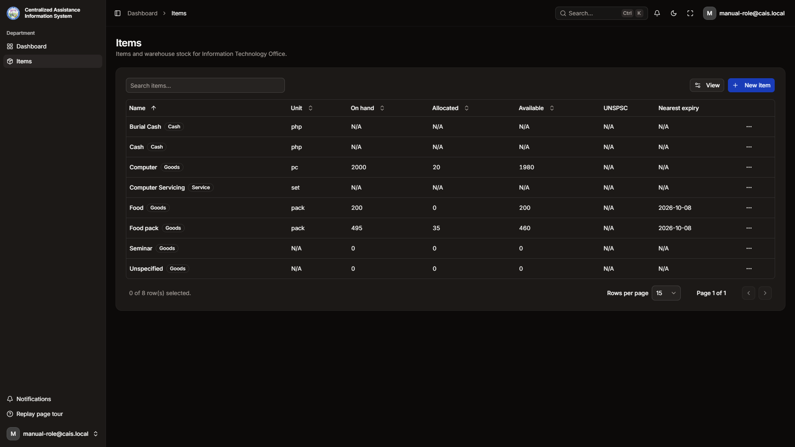

1. Open **Items**.
2. Choose **New item** for a goods, cash, or service line. Goods are the only kind that tracks stock.
3. Open a goods item and use the stock drawer.
   - **Receipt** adds stock that arrived.
   - **Allocate** sets quantity aside for a program.
   - **Adjust** records stock in or stock out, with a reason.

When on-hand stock runs low, CAIS sends a low-stock notification.

## Administrator

The administrator endorses programs and distribution batches for the whole province, then passes them to the executive. The sidebar is Programs and Distributions. There is no department dashboard.

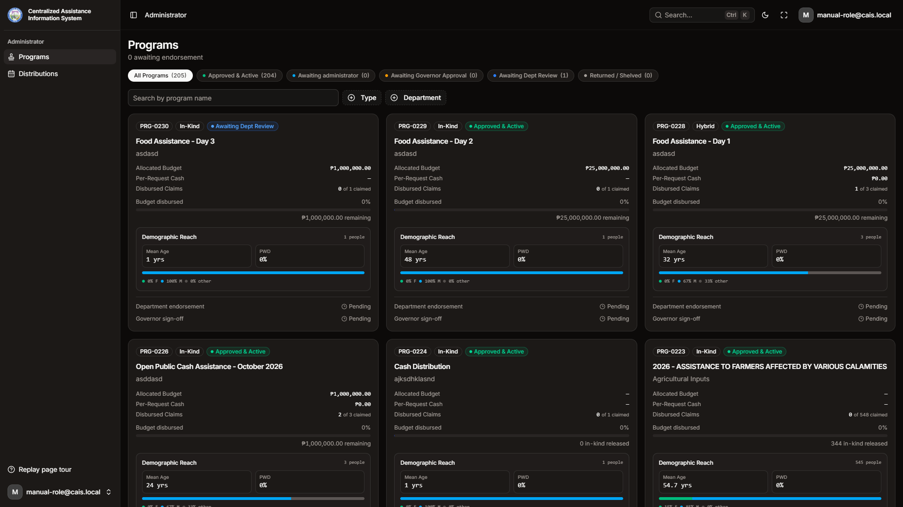

### Endorse a program

1. Open **Programs**.
2. Choose **Awaiting administrator**, or read the count “awaiting endorsement”.
3. Open the program. Choose **Recommend for approval** to send it to the executive, or **Return** to send it back to the department. A remark is optional on a recommendation and expected on a return.

### Endorse a distribution

1. Open **Distributions**.
2. Open a batch that is waiting for the administrator stage.
3. Approve the whole batch, approve selected beneficiaries, or return it. The executive still has to approve before the department can schedule the release.

## Executive

The executive approves programs and distribution batches after the administrator has endorsed them, and can review assistance, beneficiaries, and funds across departments. The sidebar is Dashboard, Programs, and Distributions.

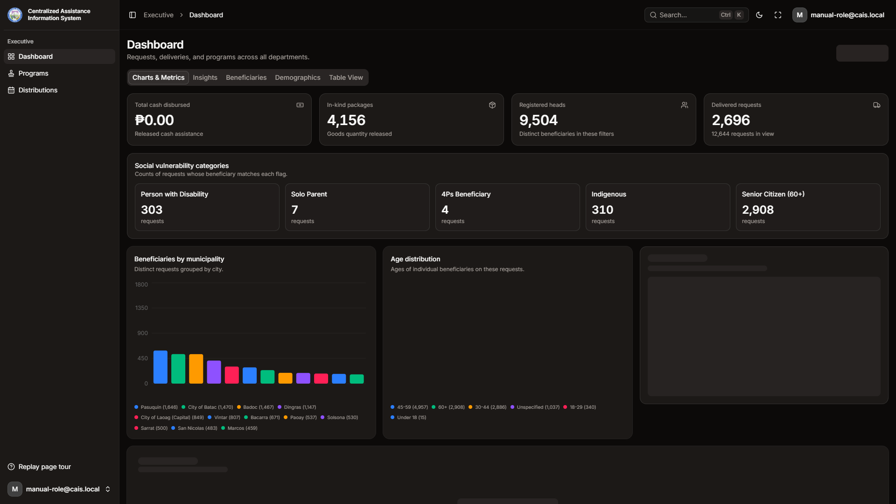

### Approve a program

1. Open **Programs**.
2. Choose the filter for programs awaiting the executive.
3. Open the program. Choose **Approve** to make it active, or **Return to department** to send it back. After approval, the department can encode requests and start releases.

### Approve a distribution

1. Open **Distributions**.
2. Open a batch waiting for executive approval.
3. **Approve whole batch**, or select beneficiaries and choose **Approve selected**, then **Finalize review**.
4. **Return** sends the roster back to the department. A reject closes that submission. The department can reopen it only when the approval policy allows a resubmit.

The executive can also change a beneficiary amount on the batch when that permission is turned on for the account.

## Super admin

The super admin has every permission, plus Administration: users, workflows, and distribution approval policies. A super admin who also belongs to a department sees that department’s sidebar as well.

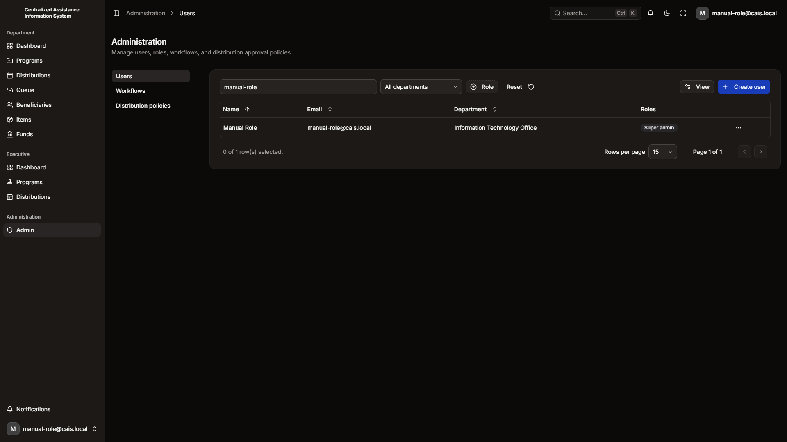

### Accounts

1. Open **Admin**, then **Users**.
2. Choose **Create user**. Enter the name, email, department, and one or more roles. Leave the department empty for an administrator or an executive who should not work inside one department.
3. The person receives an invite and sets a password.
4. You can change roles and department later, or remove an account.

### Workflows

1. Open **Workflows**.
2. Create a workflow for one department: name, code, description, and the steps and moves between them. Each step has a request status, a target time in hours, and who should own the task.
3. **Publish** it, then **Activate** it.
4. Assign it to programs, or leave programs on the department default.

New departments start with an active Standard Assistance Workflow: Submitted, Verify beneficiary, Evaluate, Approve, Prepare, Release, and Completed, with On Hold and Denied beside that path.

### Distribution policies

Open **Distribution policies** to set the approval stages for a batch. The default stages are Administrator endorsement, then Executive approval.

## Applicant

An applicant does not need an account.

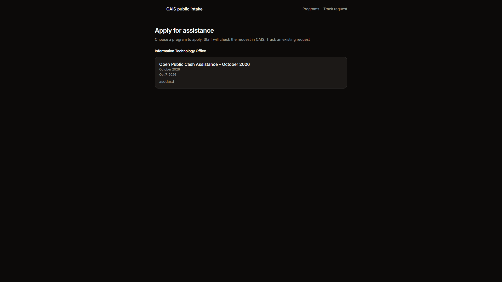

1. Open **Apply for assistance** and choose a program. A program appears there only when public intake is on, the program is for individuals, it is still open, and it is a one-off program or a batch.
2. Enter your name, birthday, sex, mobile number, and address, then continue. CAIS looks for a record that already matches you.
3. Enter the quantity for each item, answer the program questions, tick consent, and choose **Submit request**.
4. Write down the CAIS number on the confirmation screen. It looks like `PRO-2026-0001`.

To check a request later, open **Track request**, and enter the CAIS number and your last name. **Save for later** keeps a draft you can finish from the track page.

## Other roles still on some accounts

These roles are permission sets. They do not have a separate sidebar of their own. A person who still has one of them can do the work in the table, inside their department.

| Role | What it allows |
| --- | --- |
| Assistance | View, encode, edit, assign, claim, and move requests |
| Program | Create and update programs, and export their request lists |
| Beneficiary | Add and update people and organizations |
| Item | Maintain the item list and stock |
| Fund | Maintain funds |
| Workflow | View and edit the department’s workflow tasks, including assign and reassign |
| Head | Every staff action in the department |
| Supervisor | Reassign a workflow task that already has an owner, when the account can also assign work |

## Quick reference

| I want to… | Go to… |
| --- | --- |
| Apply without an account | Apply for assistance |
| Check a public request | Track request, with the CAIS number and last name |
| Propose a program | Programs, then Propose New Program |
| Send a program for approval | The program, then Submit for recommendation |
| Recommend a program | Administrator, Programs, Awaiting administrator, Recommend for approval |
| Approve a program | Executive, Programs, Approve |
| Encode a request | An approved program or batch, then Add Assistance |
| Verify a request | Queue, claim the task, then the move buttons |
| Release assistance | Distributions, then the venue desk after the batch is in progress |
| Update stock | Items, then the item’s stock drawer |
| Add a staff account | Admin, Users, Create user |
